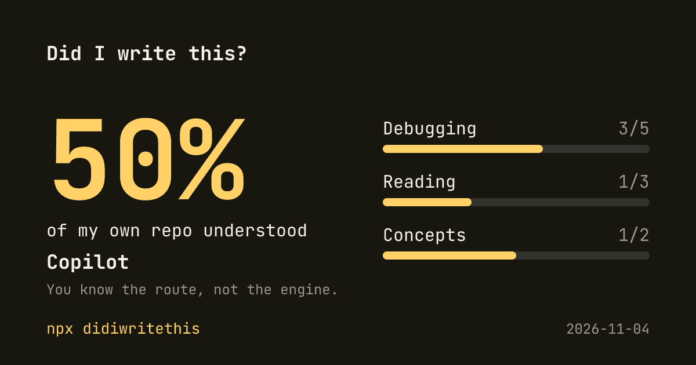

# Did I write this?

Your agent wrote it. You shipped it. Do you understand it?

```bash
npx didiwritethis
```

Ten questions about your own repo, three minutes, one honest score. No account, no API key, no git hook.




## Why

In [Anthropic's randomized trial](https://www.anthropic.com/research/AI-assistance-coding-skills) of 52 developers, the group using AI scored 50% on a comprehension quiz about code they had just worked on. The group coding by hand scored 67%. The gap was largest on debugging, and how people used AI mattered more than whether they used it.

The trial was small and measured short-term understanding of one library. So measure your own repo instead.

## How it works

1. **Picks files.** It takes the source files you changed most in your own commits and favours commits that credit an agent. On a solo repo that is everything; use `--everyone` to include your team's code. Most agent code is not labelled, so this is a heuristic, not a detector.
2. **Asks first.** It shows which files will be sent and waits for your yes.
3. **Writes the quiz.** Your agent CLI writes more questions than it needs about those files.
4. **Checks the answers.** A second, blind pass answers every question. Questions it disagrees with are dropped.
5. **Prefers hard questions.** A third pass answers without seeing the code. Questions it gets wrong go first, because guessing them is harder.
6. **Tests you.** You get 10 questions without the code: 5 on debugging, 3 on reading and 2 on concepts. Press `?` if you don't know, which counts as wrong. Press `x` to flag a question as wrong, and it will not count.
7. **Scores you.** Score = correct answers / counted questions. There is no hidden weighting.

| Score | Rank |
| --- | --- |
| 0-49% | Passenger |
| 50-79% | Copilot |
| 80-100% | Pilot |

Pure guessing averages 25%, so the ranks are set well above that. Guessing reaches Copilot in about 8% of runs.

You get a PNG score card and a README badge.

## Close the gaps

A low score should lead somewhere. The coach skill reads your weak spots and teaches them without writing the code for you.

```bash
npx skills add halilekc6/didiwritethis
```

Then ask your agent: "Coach me on my weak spots from didiwritethis." When you finish, run the test again.

## Requirements

- macOS or Linux, with Node 20 or newer
- A git repository with commit history
- A signed-in agent CLI

| Agent | Status |
| --- | --- |
| Claude Code | Tested |
| Codex | Experimental: flags checked, not run end to end |
| Gemini CLI | Experimental: flags checked, not run end to end |

## Options

```text
--agent <name>      claude, codex or gemini (default: first one found)
--questions <n>     Number of questions, 5 to 20 (default: 10)
--files <n>         Number of files to quiz on (default: 8)
--out <path>        Where to write the score card (default: ~/.didiwritethis/card.png)
--no-card           Do not write a score card
--everyone          Quiz on all authors' code, not just your commits
--list              Show which files would be sent, then stop
-y, --yes           Skip the confirmation
```

## Privacy

Your code goes to the provider behind your own agent CLI, under your own account. It goes nowhere else, and this tool has no server.

- Files such as `.env`, keys and credentials are skipped.
- Common token patterns are redacted before sending. This is a safety net and can miss things, so check the list.
- The agent runs in an empty directory, with tools off or read-only where the CLI allows it.
- Your score and card stay in `~/.didiwritethis/`, outside your repo.
- The repo name is not on the card.

## Limits

This is a self-test, not a certificate. You can paste the questions into an AI, and you will only fool yourself. Questions are written by AI, so some can be weak even after the check: press `x` on those.

didiwritethis was itself written by a coding agent, which is exactly the problem it exists to measure.

## License

MIT. The bundled JetBrains Mono font is under the [SIL Open Font License](assets/OFL.txt).
